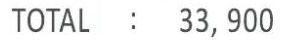

# 03 — Pipeline OCR Klasik

Dokumen ini menjelaskan pipeline pengenalan karakter dari citra struk
hingga teks, sebagaimana diimplementasikan di:

- **Rujukan Python:** `ML/ocr/` (pelatihan + ekspor model)
- **Produksi Dart:** `smart_receipt/lib/ocr/classical/` (16 file)

Keduanya menjaga urutan tahap dan parameter yang **identik**
(`ML/ocr/config.py` ↔ `lib/ocr/classical/params.dart`).

## Gambaran Umum

```
citra
  → [potong daerah kertas bila ada latar gelap]
  → deskew → bikubik resize → Sauvola → upscale adaptif
  → buang tinta di luar kertas
  → deteksi pita baris → buang garis, barcode, grafis
  → segmentasi kata → segmentasi glyph
  → normalisasi 32×32 → fitur 1844-d → classifier linear (LinearSVC)
  → beam search + LM n-gram + leksikon
  → pencocokan templat baris tetap
  → teks per baris (+ geometri)
```

Tidak ada library OCR maupun deep learning di jalur ini. Satu-satunya
dependensi eksternal tahap Dart: `package:image` — hanya untuk **dekode
berkas gambar** (PNG/JPEG → piksel RGB); seluruh algoritma citra di
bawahnya ditulis sendiri.

## 1. Praproses (`preprocess.dart` / `preprocess.py`)

Konvensi citra di seluruh pipeline: **255 = tinta, 0 = kertas**, disimpan
row-major di `Uint8List` (`GrayImage`, `BinaryImage`).

Urutan operasi:

| Langkah | Detail |
|---|---|
| Grayscale | `0.299 R + 0.587 G + 0.114 B` (bobot sama dengan OpenCV) |
| **Potong daerah kertas** | Deteksi blob terang terbesar (ambang 0.60 × persentil-90, morphological open 9, close 21). Bila blob **tidak** menyentuh keempat tepi bingkai — artinya ada latar — citra dipotong ke blob itu. Ini perbaikan untuk struk yang difoto di atas latar gelap: tanpa itu persentil-2 jatuh ke latar dan seluruh citra "jadi tinta". |
| Denoise | `bilateralFilter` (kernel lingkaran, `BORDER_REFLECT_101`) + median 3 |
| Deskew | Estimasi kemiringan via profil proyeksi (maks ±8°, ambang 0,3°), rotasi `INTER_CUBIC` |
| Binarisasi **Sauvola** | Window 25, k = 0,2, R = 128 — ambang adaptif lokal |
| Upscale adaptif | Target tinggi baris 48 px, maksimal 5×; skala dihitung dari tinggi baris **hasil binarisasi**, bukan ditebak |

Dua detail OpenCV yang **wajib** ditiru di port Dart (perbedaan 1–2 level
abu-abu saja sudah merusak binarisasi): kernel bilateral berbentuk
**lingkaran** dan rotasi deskew memakai **bikubik**, bukan bilinear.

## 2. Deteksi Baris (`lines.dart`, `rules.dart`)

- **Proyeksi horizontal** jumlah piksel tinta per baris piksel, dengan
  ambang relatif terhadap lebar citra → kandidat pita baris (`LineBox`).
- Pita yang terlalu tinggi (dua baris menempel) dipecah di lembah profil
  (`splitTallBands`), fragmen berdekatan digabung, celah kecil diisi.
- Setiap pita diklasifikasi (`classifyBand`):
  - **garis** — run tinta solid/dashed yang menutupi hampir seluruh lebar
  - **barcode** — banyak bar vertikal berjarak seragam (koefisien
    variasi < 0,25, tinggi ≥ 1,6× median)
  - **grafis** — logo/wordmark (run tinta > ½ lebar)
  - **teks** — sisanya

Pita selain teks dibuang sebelum OCR.

## 3. Segmentasi Kata & Glyph (`words.dart`, `chars.dart`)

- **Kata:** ambang celah kata dinyatakan **relatif terhadap lebar sel
  huruf**, bukan terhadap median celah. Contoh konkret: pada `2 X 9.800`,
  celah antar-huruf 23 px dan celah kata 44 px.
- **Glyph:** connected components 8-konektivitas pada pita kata →
  komponen bertumpuk digabung (diakritik, titik `i`/`j`) → komponen
  lebar dipecah rekursif di lembah profil vertikal.
- **Glyph kecil** (tinggi < 0,55× median baris) diperlakukan sebagai
  tanda baca: probabilitas kelas dibatasi ke `. - / % + &`.

## 4. Normalisasi & Fitur 1844-d

Setiap glyph dipotong ke *tight bounding box* piksel tinta (bukan metrik
font — agar distribusi latih sama dengan inferensi), lalu diskalakan
ke kanvas **32×32** dengan rasio terjaga (pad 2) dan digeser ke tengah
massa (interpolasi bilinear).

Fitur yang diekstrak (`features.dart`), total **1844 dimensi**:

| Fitur | Dimensi | Penjelasan |
|---|---|---|
| **HOG** | 1764 | Gradien (beda tengah), orientasi mod 180°, 9 bin, cell 4×4, blok 2×2 dengan interpolasi trilinear |
| **Zoning** | 48 | Grid 4×4 × (densitas tinta, centroid x, centroid y) |
| **Proyeksi** | 24 | 16 proyeksi kolom + 8 proyeksi baris |
| **Topologi lubang** | 8 | Jumlah lubang + 3 luas terbesar + posisi (cx, cy) |

Pilihan HOG `cell = 4` (bukan 8, standar) disengaja: goresan nol bergaris
miring pada font thermal baru tertangkap pada resolusi sel ini.

## 5. Klasifikasi Karakter (`char_classifier.dart`)

- Model: **LinearSVC multikelas** (42 kelas: `0–9`, `A–Z`, `.&-/%+`).
  Tidak ada pelatihan di perangkat — bobot dibaca dari
  `assets/ocr/char_clf.json` (42 × 1844 + bias + suhu).
- `decisionFunction` → skor per kelas; `predictProba` → softmax
  **bertemperatur** (kalibrasi dari temperature scaling saat latih).
- `argmax` untuk decoding tanpa model bahasa.

### Cara model dilatih (`ML/ocr/`)

1. **Dataset sintetis** (`corpus.py`, `render_dataset.py`): korpus baris
   struk realistis dirender dengan berbagai font/ukuran/rotasi/blur/noise,
   termasuk variasi **penyempitan horizontal** (font thermal jauh lebih
   sempit, aspek ~0,42 vs ~0,85) dan pola huruf kecil berlabel kapital
   (karena charset tetap kapital).
2. **Split bebas kebocoran**: `text_index` menandai baris sumber setiap
   karakter, sehingga pembagian train/val/test dilakukan **per baris**,
   bukan per karakter — tidak ada karakter dari baris yang sama di dua
   split.
3. **Booster kelas langka** (`Q`, `V`, `Z`, `&`, `+`) ditambah sampai
   ≥ 2000 sampel; kelas dominan (`-` dari baris `-----`) dibatasi.
4. `train_char.py` melatih LinearSVC dan menskalakan suhu; `export_char.py`
   mengekspor JSON + `golden_vectors.json` untuk uji paritas.

## 6. Decoding: Beam Search + LM + Leksikon (`decode.dart`)

Classifier menghasilkan, untuk setiap glyph, distribusi probabilitas atas
42 kelas. Rangkaian distribusi itu diubah menjadi kata oleh
**beam search** (`beamWidth = 8`) dengan:

- **Model bahasa karakter n-gram order 5** (`lm.dart`, `lm.json`),
  interpolasi dengan `floor`. Bobot gabungan `lmWeight = 0,6`.
- **Leksikon** (`lexicon.dart`, `lexicon.json`) berisi kata-kata umum
  struk Indonesia + **weighted Levenshtein** dengan biaya substitusi
  khusus untuk pasangan karakter yang mudah tertukar. Leksikon **hanya
  cadangan**: dilewati ketika classifier sudah yakin (≥ 0,95).
- **Normalisasi pasca-decode:** spasi dirapikan (`8 . 700` → `8.700`),
  artefak garis dibuang, dan **token angka tidak pernah dikoreksi
  leksikon** — hanya huruf yang bentuknya sama (`O`→`0`, `I`→`1`,
  `S`→`5`), dan hanya bila hasilnya tetap berbentuk angka.

Contoh nyata dari struk asli Indomaret (`testdata/real/`) — baris
`TOTAL : 33, 900` pada struk dicetak dengan spasi, dan `:` tidak ada di
charset sehingga terbaca `.`:



Keluaran decoder: `TOTAL.. 33.900` — koma menempel ke kata sebelumnya
(tanda baca berdiri sendiri), spasi dirapikan, dan nominal tetap utuh.

### Templat baris tetap (`templates.dart`)

Baris yang identik antarstruk (alamat toko, footer, label) dicocokkan ke
templat (`snap`) — dengan **penjaga tanda tangan angka**, sehingga alamat
boleh diperbaiki tetapi harga tidak bisa berubah.

## 7. Model Bahasa & Leksikon: format

Semua model diekspor sebagai **JSON** agar bisa diport ke Dart tanpa
konversi biner:

| Aset | Ukuran | Isi |
|---|---|---|
| `char_clf.json` | ~734 KB | Bobot LinearSVC 42×1844 + suhu |
| `lm.json` | ~553 KB | N-gram karakter order 5 |
| `lexicon.json` | ~28 KB | Kata + biaya konfusi antar-karakter |
| `templates.json` | ~1,2 KB | Baris tetap |
| `golden_vectors.json` | ~3 MB | Glyph + fitur + probabilitas rujukan Python |

Total model yang dikirim ke perangkat ~1,3 MB (target desain < 20 MB).

## 8. Menjalankan di Perangkat (`classical_ocr_engine.dart`)

`ClassicalOcrEngine implements OcrEngine`:

1. `load()` — memuat & memvalidasi keempat JSON sekali; kesalahan muncul
   saat memuat, bukan saat memindai.
2. `recognize(path)` — dekode berkas (`package:image`), `bakeOrientation`,
   pastikan 3 kanal, lalu jalankan pipeline penuh di **`Isolate.run`**.
   Tanpa isolate, OCR satu struk memblokir UI puluhan detik hingga
   Android menampilkan "aplikasi tidak merespons".
3. `needsRawImage = true` — pipeline klasik melakukan deskew, binarisasi,
   dan upscale sendiri; menerima gambar yang sudah diputar/di-unsharp/
   di-JPEG ulang justru menghilangkan goresan tipis.

Alur lengkap di level aplikasi (termasuk strategi cadangan dan gagal-nya)
ada di [02 — Arsitektur Aplikasi](02-arsitektur-aplikasi.md).

## 9. Keterbatasan yang Diakui

- `0` vs `O` pada font tanpa garis miring masih ambigu (dibantu aturan
  kata dan leksikon).
- Baris total dengan campuran huruf kecil (`Total Belanja`) kadang
  meleset.
- `:` `,` `(` `)` tidak ada di charset (42 kelas) sehingga terbaca `.`.
- Port Dart dan Python bisa berbeda 1 glyph pada batas font sintetis
  tertentu karena perbedaan floating-point.
