# 04 — Parser Struk & Koreksi Teks

Dua modul mengubah output mesin OCR (teks per baris + kotak geometri)
menjadi data transaksi terstruktur:

- `lib/ocr/ocr_text_corrector.dart` — koreksi karakter **sebelum** parse.
- `lib/ocr/receipt_parser.dart` — teks → `ParsedReceipt`.

## 1. Koreksi Teks Pasca-OCR

Fungsi `correctOcrText(raw)` mempertahankan geometri dan hanya mengubah
teks setiap baris. Tiga aturan, diterapkan berurutan:

1. **Kata kunci struk** — tabel penggantian untuk label yang rusak OCR
   (`T0TAL` → `TOTAL`, `TUNA l` → `TUNAI`, `QR l S` → `QRIS`, normalisasi
   `Rp`). Label benar dulu penting karena parser bergantung padanya untuk
   menemukan total dan metode pembayaran.
2. **Bagian nama** (kiri baris) — angka yang mirip huruf diganti bila
   diapit huruf: `0→O, 1→I, 5→S, 8→B, 6→G, 2→Z`.
3. **Bagian nominal** (blok angka di kanan) — huruf yang mirip angka
   diganti: `O/o, l/I/i, S/s, B, Z/z, G/g → angka`. Pemisah ribuan
   yang terbaca huruf dipulihkan (`8O700` → `8.700`), dan format ribuan
   dinormalisasi (`10,000` → `10.000`).

## 2. Struktur Hasil Parser

```dart
class ParsedReceipt {
  final String store;            // nama toko
  final DateTime? date;          // tanggal transaksi
  final List<ParsedItem> items;  // item yang dibeli
  final int total;               // total tercetak, atau jumlah item
  final String paymentMethod;    // Tunai, QRIS, ...
  final int itemsTotal;          // jumlah subtotal item
  final int discountTotal;       // total diskon (positif)
  final bool totalFromReceipt;   // total berasal dari baris TOTAL?
  final String source;           // 'geometri' | 'kolom' | 'teks'
  final List<String> warnings;   // peringatan non-fatal
}

class ParsedItem {
  final String name;
  final int qty;
  final int price;        // harga satuan
  final int lineTotal;    // total baris (dari struk)
}
```

## 3. Empat Tahap Parser

### Tahap 1 — Rekonstruksi baris visual

Mesin OCR mengembalikan sel teks dengan bounding box, **bukan** baris
visual. Parser mencoba **tiga rekonstruksi** sekaligus, lalu memilih
yang skornya terbaik:

| Sumber | Cara |
|---|---|
| `geometri` | Kelompokkan sel berdasarkan pusat vertikal (toleransi 0,6× median tinggi baris), urutkan kiri→kanan |
| `kolom` | Jadikan baris teks sebagai anchor, tempelkan sel angka terdekat di kanannya (aman saat jumlah baris per kolom berbeda) |
| `teks` | Satu sel = satu baris (cadangan terakhir) |

Semua jalur melewati `_mergeStackedCells`: menyatukan baris angka yang
tercetak **di atas** atau **di bawah** nama produk (maksimal 2 baris),
dengan penanda "owner" agar angka tidak terambil item yang salah. Ini
menangani dua tata letak umum: gaya Indomaret (total di atas nama) dan
kebanyakan minimarket (angka di bawah nama).

### Tahap 2 — Klasifikasi baris

Setiap baris diberi label menggunakan daftar kata kunci:

- **total:** `grand total`, `total bayar`, `total`, `jumlah`, `tagihan`, …
- **pembayaran:** `tunai`, `cash`, `debit`, `qris`, `gopay`, `ovo`, …
- **diskon:** `diskon`, `potongan`, `voucher`, `hemat`
- **noise:** `PPN`, `DPP`, `kembalian`, `NPWP`, nomor telepon, dll.

Karena OCR sering merusak **label** (`DPP`→`D+DP`, `TOTAL`→`TKDTAL`),
label dicocokkan dengan **jarak edit Levenshtein ≤ 2** (dan huruf awal
yang diharapkan: `T…` untuk TOTAL, `J…` untuk JUMLAH), bukan regex
persis. Pemeriksaan kata pertama baris saja mencegah nama produk yang
kebetulan mirip ikut terfilter (mis. `BOTOL` berjarak edit 2 dari
`TOTAL`).

Ini bukan kasus hipotetis — beginilah label sungguhan pada struk asli
Alfamart (`testdata/real/`): `TOTAI` (jarak 1 dari TOTAL), `KEMBAII.AT`
(tetap dikenali via kata `KEMBAL…`), dan `PPN C`:

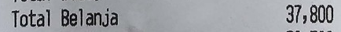

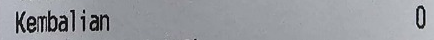

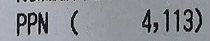

Item didaftar hanya sampai **baris ringkasan pertama** (TOTAL, DPP, PPN,
pembayaran); setelah itu tidak ada item lagi. Ini mencegah baris rusak
terdeteksi sebagai item.

### Tahap 3 — Interpretasi angka item

Baris item berakhir dengan blok angka. Contoh nyata dari struk asli
Indomaret (`testdata/real/`):

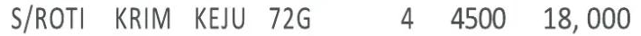

yang oleh OCR dibaca `S/ROTI KRIM KEJU 72G 4 4500 18,000` (keyakinan
0,986). Parser mengambil sampai **3 angka terakhir** sebagai `(qty,
harga, total)` — di sini `4`, `4500`, `18.000` — tetapi karena urutan
kolom berbeda antarprinter, ia menyimpan semua pembacaan yang masuk
akal sebagai kandidat:

- `qty × harga = total`
- `total qty harga` (gaya Indomaret)
- `qty total harga`
- apa adanya (diskon tingkat baris)

Aturan tambahan:
- Angka tunggal < 1000 tanpa pemisah kemungkinan bagian nama
  (`ROKOK MILD 16`)
- Angka pertama > 99 pada tiga angka yang tidak saling mengalikan
  dianggap ukuran kemasan (`FF LOW FAT VAN 225 5200 5.200`)
- Nominal yang terpecah OCR disatukan kembali (`18,`+`000`,
  `69`+`O`+`300`, `34`+`0300`)
- Harga negatif = diskon/retur, bukan item

### Tahap 4 — Rekonsiliasi terhadap total

Jika struk mencetak `TOTAL`, parser memilih pembacaan setiap item yang
menjumlahkan ke **total tercetak + diskon** (algoritma greedy 2 pass).
Inilah yang mencegah harga tertempel pada item yang salah.

Fungsi skor (`ReceiptParser.scoreOf`) meranking keseluruhan hasil:

| Komponen | Skor |
|---|---|
| Setiap item | +10 |
| Ada total tercetak | +20 |
| Total cocok dengan item (selisih ≤ 1) | +100 |
| Selisih ≤ 100 | +10 |
| Tidak ada item | −50 |

Skor yang sama dipakai `OcrService` untuk memilih di antara strategi
pemindaian ulang.

## 4. Ekstraksi Total, Diskon, Pembayaran, Toko

- **Total** — dicari dari bawah ke atas, mengutamakan `GRAND TOTAL`
  lalu `TOTAL BAYAR`, melewati `SUB TOTAL` dan baris jumlah item.
  Cadangan bila baris TOTAL rusak:
  1. `TOTAL` + baris `PEMBULATAN`;
  2. nominal pembayaran non-tunai (DEBIT/QRIS = total belanja persis).
  Nilai total Rupiah < 100 ditolak (kemungkinan jumlah item).

  Contoh nyata. Pada struk Indomaret asli, baris total terbaca bersih
  dan nilai `33.900` terpilih sebagai total:

  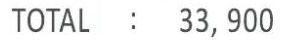

  Pada struk Alfamart asli, labelnya rusak (`TOTAI`, `BEIATJ.D`) tetapi
  tetap dikenali via jarak edit dan `37.800` terekstrak. **Namun** nilai
  akhirnya ditimpa oleh cadangan non-tunai: nominal `DANA QRIS 20.500`
  dianggap "non-tunai = total" (asumsi yang benar untuk pembayaran
  penuh, tetapi keliru untuk **pembayaran split** 20.500 QRIS +
  17.300 tunai), sehingga total terpilih menjadi 20.500. Selisih 18.700
  terhadap jumlah item memunculkan `warning` di layar review —
  keterbatasan yang diakui, lihat [14 — Contoh Per Langkah](14-contoh-struk.md).

  

- **Diskon** — dijumlahkan dari baris berlabel diskon, kecuali baris
  ringkasan hemat (`ANDA HEMAT`) yang akan menduplikasi diskon.
  Pada struk Indomaret asli, nilai baris `DISKON FRISIAN FLAG` rusak
  oleh OCR (`I1.300G`) sehingga gagal dipulihkan dan diskon tidak
  terhitung (limitasi nyata); baris `ANDA HEMAT : 1,300` — restatement
  dari diskon yang sama — memang dirancang untuk dilewati agar tidak
  dihitung ganda:

  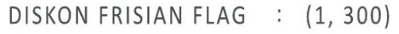

  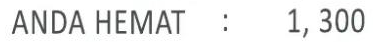

  Kasus Alfamart lebih ekstrem: `Disc. -3,700` terbaca rusak menjadi
  `01.SC. -39700`, sementara `TOTAI DISC. 39700` terbaca sebagai diskon
  39.700 (nilai salah — titik pemisah ribuan hilang). Hasilnya ikut
  memicu warning di atas:

  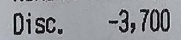

- **Pembayaran** — kata kunci terakhir pada baris, dinormalisasi
  (`cash` → `Tunai`, `qris` → `QRIS`); default `Tunai`. Pada struk
  Indomaret asli, `TUNAI 40.000` adalah **uang yang diserahkan** (bukan
  total) dan `KEMBALI 6.100` kembaliannya — 40.000 − 6.100 = 33.900
  persis sama dengan total:

  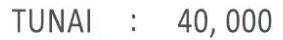

  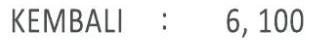

- **Toko** — 15 minimarket dikenal (`Indomaret`, `Alfamart`, …) plus
  *stem* yang toleran OCR (`alfam…`); fallback ke baris pertama yang
  bukan angka/noise; jika tidak ada → `Struk Tanpa Nama`. Pada struk
  asli, nama toko ditemukan dari header/footer:

  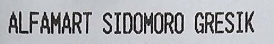

  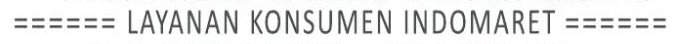

- **Tanggal** — dari pola tanggal/jam, dengan pengecualian nomor
  NPWP/telepon agar tidak salah dikenali.

## 5. Penanganan Gagal

`OcrService` membedakan jenis kegagalan agar pengguna mendapat petunjuk
yang tepat:

| Kondisi | Pesan |
|---|---|
| Tidak ada engine | `Mesin OCR belum tersedia.` |
| Berkas tidak valid | `Gambar tidak dapat diproses.` |
| Tidak ada kertas struk di foto | `Struk tidak terdeteksi pada foto.` |
| Ada kertas tapi teks kosong | `Tidak ada teks yang terbaca pada struk.` |

Peringatan non-fatal (`warnings`) seperti "Total struk dan jumlah item
berbeda X rupiah" ditampilkan di layar review agar pengguna memeriksa
harga item.
