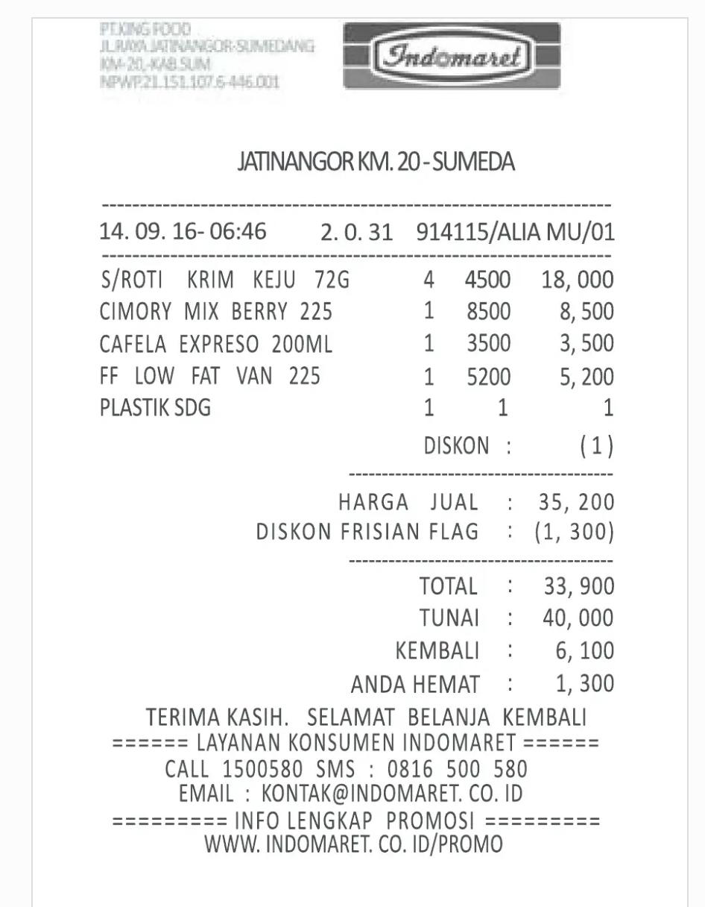
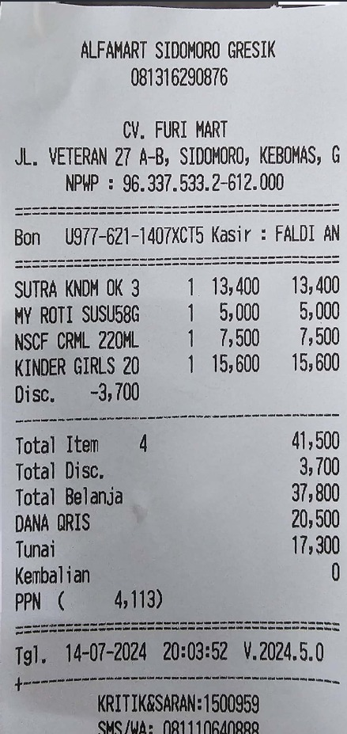
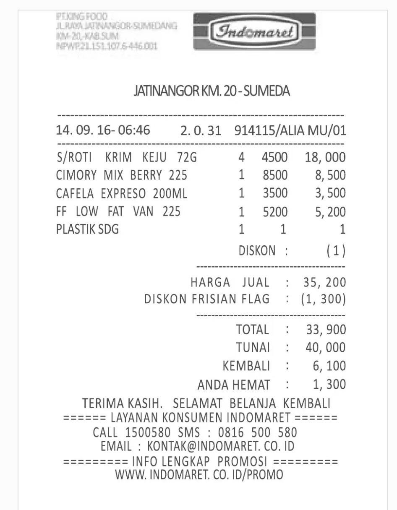
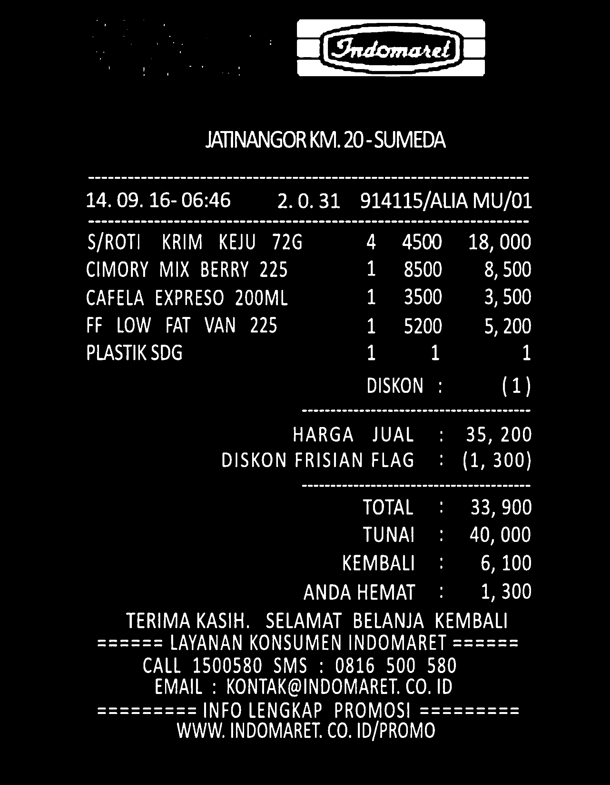
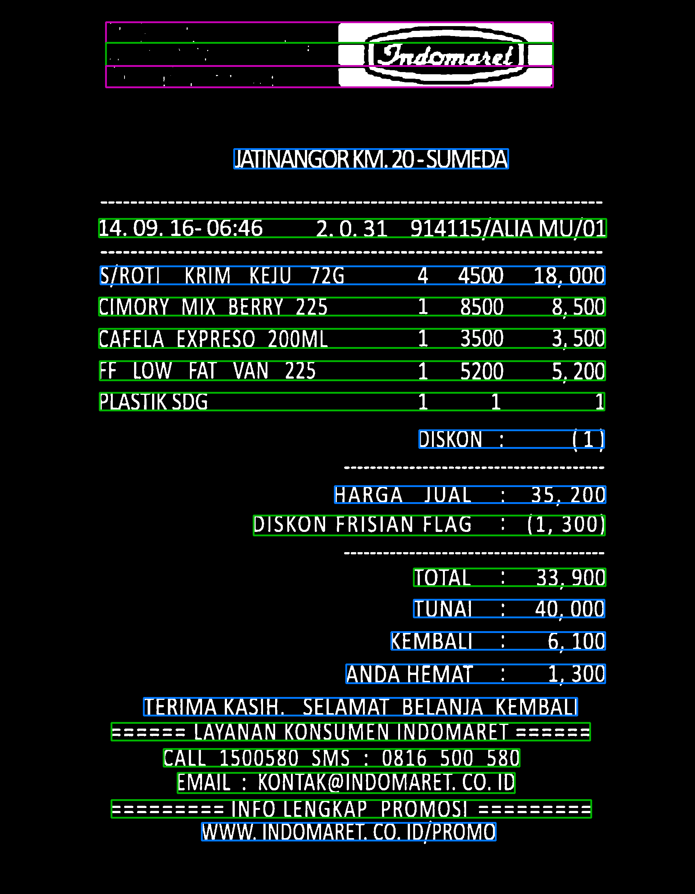
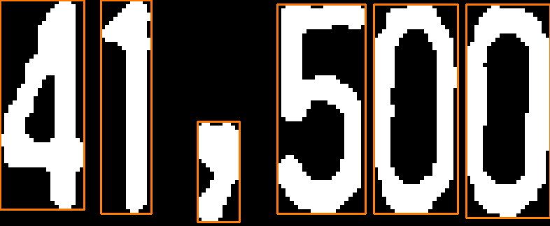
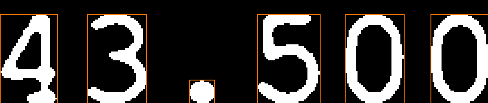

# 14 — Contoh Per Langkah: Struk Nyata & Fixture

Dokumen ini membedah pipeline **tahap demi tahap** memakai keluaran
nyata — bukan ilustrasi — dari dua jenis bahan uji:

| Bahan | Jumlah | Sifat | Ground truth |
|---|---|---|---|
| Foto struk asli (`testdata/real/`) | 2 | Foto ponsel, font thermal asli, di luar domain latih | Verifikasi manual |
| Fixture sintetis (`test/fixtures/receipts_v2/`) | 10 | Dirender, variasi font/rotasi/noise, **test terkunci** | `ground_truth.json` ✔ |

Variasi yang dicakup: format item satu-baris (`POCARI SWEAT 500ML
8.700`) dan dua-baris (`3 X 14.500  43.500`), diskon struk, pembulatan,
pembayaran **OVO / QRIS / GOPAY / TUNAI / DEBIT BCA / DEBIT MANDIRI**,
sampai struk dengan **dua baris TOTAL** (subtotal → diskon → total
akhir).

> Semua angka di bawah dihasilkan `ML/ocr/pipeline.py` pada tanggal
> dokumentasi ditulis; skrip & data lengkap: `docs/assets/gen_struk.py`,
> `report.json`, `fixtures.json`.

---

# Bagian A — Foto Struk Asli

## Langkah 0 — Citra Masukan





| Struk | Dimensi | Kemiringan | Skala upscale |
|---|---|---|---|
| Indomaret (`indomaret_01.png`) | 946×1216 | −0,1° | 2,0× |
| Alfamart (`alfamart_01.jpeg`) | 439×927 | −0,8° | 2,18× |

Alfamart miring 0,8° dan beresolusi kecil — profil yang dulu membuat
OCR lama gagal total.

## Langkah 1 — Grayscale & Deteksi Kertas

Grayscale memakai bobot OpenCV (`0.299 R + 0.587 G + 0.114 B`). Masker
kertas (`_paper_mask`) dicari untuk kasus latar gelap; pada kedua foto
ini latar sudah putih sehingga **tidak ada pemotongan** — jalur normal
berjalan tanpa regresi.



## Langkah 2 — Binarisasi Sauvola + Upscale Adaptif

Urutan: binarisasi awal → estimasi kemiringan → rotasi (bila ≥ 0,3°) →
binarisasi Sauvola final → upscale adaptif ke tinggi baris 48 px.
Alfamart dirotasi; Indomaret tidak (kemiringannya di bawah ambang).



Perhatikan: garis putus-putus, logo, dan barcode ikut menjadi tinta —
pembersihannya bukan tugas binarisasi, melainkan tahap berikutnya.

## Langkah 3 — Deteksi & Klasifikasi Pita Baris

Proyeksi horizontal menghasilkan kandidat pita, lalu `classifyBand`
memilahnya. Hasil pada Indomaret: **23 pita** — 12 teks, 9 barcode,
2 grafis (logo). Setelah `filter_bands`, tersisa **21 pita teks**.
Pada Alfamart: 27 pita (26 teks, 1 grafis) → tersisa 23.

Warna kotak: hijau = teks (diproses), oranye = barcode, ungu = grafis
(dibuang).



## Langkah 4 — Segmentasi Kata

Contoh pada baris `TOTAL ITEM 4 41,500` (Alfamart). Pita dipotong, lalu
segmentasi kata memisahkannya menjadi 4 kata — termasuk memisahkan
`41,500` dari kolom angka lain.


Pada struk sintetis (fixture `indomaret_10`), format dua-baris
`3 X 14.500  43.500` menjadi 4 kata: `3`, `X`, `14.500`, `43.500`:


## Langkah 5 — Segmentasi Glyph

Kata `41,500` dipecah menjadi **6 glyph**: `4`, `1`, `,`, `5`, `0`,
`0`. Koma ikut menjadi glyph sendiri — ia ada di charset (simbol
`.&-/%+`), jadi tidak hilang.



Pada fixture 10, kata `43.500` menjadi 6 glyph:



## Langkah 6 — Normalisasi 32×32

Setiap glyph dipotong *tight*, diskalakan rasio terjaga ke kanvas 32×32,
lalu digeser ke pusat massa. Inilah masukan classifier — identik dengan
cara data latih dirender (`render_dataset.py`).


## Langkah 7 — Klasifikasi (Probabilitas Nyata per Glyph)

**Alfamart — kata `41,500`:**

| Glyph | 1 | 2 | 3 |
|---|---|---|---|
| `4` | **4** = 1,000 | Q = 0,000 | 0 = 0,000 |
| `1` | **1** = 0,980 | I = 0,016 | Y = 0,001 |
| `,` | **.** = 0,453 | − = 0,345 | % = 0,192 |
| `5` | **5** = 1,000 | U = 0,000 | 6 = 0,000 |
| `0` | **0** = 0,882 | O = 0,098 | 9 = 0,008 |
| `0` | **0** = 0,496 | O = 0,400 | U = 0,073 |

Argmax murni sudah menghasilkan `41.500` — koma terbaca titik karena
charset memang tidak punya koma. Glyph terakhir nyaris seri
(`0` 0,496 vs `O` 0,400).

**Indomaret asli — kata `900`** (dari baris `TOTAL : 33,900`; `33` dan
`,` menjadi kata terpisah):

| Glyph | 1 | 2 | 3 |
|---|---|---|---|
| `9` | **9** = 1,000 | E = 0,000 | − = 0,000 |
| `0` | **O** = 0,795 | 0 = 0,200 | A = 0,002 |
| `0` | **0** = 0,854 | O = 0,132 | E = 0,007 |

Di sini argmax **salah**: glyph tengah terbaca `O` — argmax murni
menghasilkan `9O0`.


**Fixture `indomaret_04` — kata `4.700`** (baris `2 X 4.700  9.400`):

| Glyph | 1 | 2 | 3 |
|---|---|---|---|
| `4` | **4** = 1,000 | Q = 0,000 | & = 0,000 |
| `.` | **.** = 1,000 | + = 0,000 | − = 0,000 |
| `7` | **7** = 1,000 | J = 0,000 | 9 = 0,000 |
| `0` | **O** = 0,601 | 0 = 0,389 | − = 0,004 |
| `0` | **O** = 0,901 | 0 = 0,095 | − = 0,001 |

Argmax memberi **`4.7OO`** — DUA glyph salah sekaligus. Ini kasus
paritas yang dikutip [06 — Evaluasi](06-evaluasi-pengujian.md)
(`4.700→0.700` di port Dart): font fixture membuat `0` tertutup
menyerupai `O`.

**Fixture `indomaret_10` — kata `43.500`:**

| Glyph | 1 | 2 | 3 |
|---|---|---|---|
| `4` | **4** = 0,990 | 0 = 0,008 | Q = 0,000 |
| `3` | **3** = 1,000 | − = 0,000 | S = 0,000 |
| `.` | **.** = 1,000 | − = 0,000 | + = 0,000 |
| `5` | **5** = 1,000 | 6 = 0,000 | S = 0,000 |
| `0` | **O** = 0,716 | 0 = 0,280 | − = 0,001 |
| `0` | **O** = 0,645 | 0 = 0,350 | − = 0,002 |

Argmax: **`43.5OO`** — pola yang sama: nol akhir kalah dari `O`.

## Langkah 8 — Decoding: di Mana Kesalahan Diperbaiki

Beam search (`beamWidth = 8`) menimbang probabilitas classifier dengan
skor LM n-gram order 5, lalu aturan token dan leksikon menutup sisanya.
Empat kasus nyata dari atas:

| Masukan (argmax) | Keluaran | Mekanisme penyelamat |
|---|---|---|
| `41.500` (Alfamart) | `41.500` ✔ | Normalisasi pemisah ribuan pada konteks nominal |
| `9O0` (Indomaret asli) | `900` ✔ | Aturan `normalize_alpha_token`: `O`→`0` bila token berbentuk angka |
| `4.7OO` (fixture 04) | `4.700` ✔ | LM + aturan token angka; inilah batas tempat port Dart sempat meleset menjadi `0.700` |
| `43.5OO` (fixture 10) | `43.500` ✔ | Idem — dua nol akhir dikoreksi sekaligus |

Leksikon **tidak** menyentuh token angka — hanya huruf yang dikoreksi,
dan hanya bila hasilnya tetap berbentuk angka.

## Langkah 9 — Keluaran Pipeline Lengkap

**Indomaret asli (21 baris):**

```
... N O.... -IIIIO-IROOO9.WIIIIRO...IJL.JJII4ITITRRIRIJI.ITIIJJ9IIIT-.AIIIILA.IIIIOOJI.
MANANGORKM.ZO-SUMEDA
14.09. 16-06..46 2.O. 31 914115/ALIAMU/01
S/ROTI KRIM KEJU 72G 4 450G 18.000
CIMORY MIX BERRY 225 1 8500 8.500
CAFELA EXPRESO 200NIL 1 3500 3.500
FF LOVV FAT VAN 225 1 520G 5.200
PLASTIKSDG 1 1 1
DISKON.. I 1 J
HARGA JUAL.. 35.200
DISKON FRISIAN FLAG.. I1.300G
TOTAL.. 33.900
TUNAI.. 40.000
KEMBALI.. 6.100
ANDA HEMAT.. 1.300
TERIMA KASIH. SELAMAT BELANJA KEMBALI
LAYANAN KONSUMEN INDOMARET
CALL 150058G SMS.. 08xx xxx xxx
EMAIL.. KONTAKEINDOMARET. CO. ID
INFO LENGKAP PROMOSI
WWW. INDOMARET.CO. ID/PROMO
```

**Alfamart asli (21 baris):**

```
ALFAMART SIDOMORO GRESIK
08xx-xxxx-xxxx
CV. FURI MART
JL. VETERAN 27 A-B. SIDOMORO- KEBOMAS. G
NPWP.. NN.NNN.NNN.N-NNN.NNN
BON U977-621-1407XCT5 KDSI.R.. XXXXX XX
SUTRA KNDM 0K 3 1 13.400 13.400
MY ROTI SUSUSBG 1 5.000 5.000
NSCF CRML 220ML 1 7.500 7.500
KINDER GIRLS 20 1 15.600 15.600
01.SC. -39700
TOTAL IT%N 4 41.500
TOTAI DISC. 39700
TOTAI BEIATJ.D 37.800
DANA QRIS 20.500
TUNAI 17.300
KEMBAII.AT 0
PPN C 4.113J
T91. 14-07-2024 20..03..52 V.2024.5.0
KRITIK&SARAN..1500959
NO.S/VA..IIRIIIMAMKMPQQ
```

**Fixture `indomaret_01` (22 baris)** — perhatikan struktur rumitnya:
header `IT-SM TOTAL` (bukan baris total!), subtotal `TOTAL 49.700`,
diskon, lalu total akhir `TOTAL 47.200`:

```
INDOMARET
SERBA ADA SERBA MUDAH
JL. RAYA KIVO 12. KEL. SUKAPURA
KEC. CILINCING JAKARTA UTARA
STORE 1%IO. 0001 K0xxx xxxxxxx
NO.. xxxxxxxx 07/O1/2O25
KSR.. X. XXXXXX 18..44..36
IT-SM TOTAL
KAPAS KECIL TOP84 12.500
POCARI SWEAT 500ML 8.700
MARLBORO MERAH 12 28.500
TOTAL 49.700
DISKON 2.500
TOTAL 47.200
DPP 42.523
PPN 11% 4.677
OVO 47.200
TERIMA KASIH ATAS KUNJUNGAN ANDA
BARANG YANG SUDAH DIBELI
TIDAK DAPAT DITUKAR KEMBALI
0xxxxxxxxxxxxxxx
```

Kesalahan yang masih terlihat pada foto asli: `LOVV` (`LOW`), `200NIL`
(`200ML`), `520G` (`5200`), `TOTAI` (`TOTAL`), `BEIATJ.D` (`BELANJA`),
`01.SC.` (`Disc. -3,700`). Nama barang dan **seluruh harga terbaca
benar** — dan itu yang paling penting bagi parser.

---

# Bagian B — Verifikasi 10 Fixture Terkunci

Pipeline dijalankan pada seluruh `receipts_v2` dan dibandingkan dengan
`ground_truth.json`. **Total tercetak cocok di 10/10 struk**, dan
seluruh baris barang terbaca — satu-satunya perbedaan dengan ground
truth adalah spasi ganda yang menyatu (`43.500` vs `43.500`):

| Fixture | Baris GT | Match persis | Total GT | Total OCR | Pembayaran |
|---|---|---|---|---|---|
| indomaret_01 | 11 | 11/11 | 47.200 | 47.200 | OVO |
| indomaret_02 | 15 | 13/15 | 153.700 | 153.700 | TUNAI + KEMBALI |
| indomaret_03 | 14 | 13/14 | 67.900 | 67.900 | TUNAI |
| indomaret_04 | 10 | 9/10 | 17.400 | 17.400 | DEBIT BCA |
| indomaret_05 | 11 | 9/11 | 86.300 | 86.300 | DEBIT MANDIRI |
| indomaret_06 | 11 | 11/11 | 43.400 | 43.400 | QRIS |
| indomaret_07 | 16 | 16/16 | 114.700 | 114.700 | GOPAY |
| indomaret_08 | 17 | 15/17 | 95.400 | 95.400 | DEBIT MANDIRI |
| indomaret_09 | 15 | 14/15 | 72.100 | 72.100 | DEBIT BCA |
| indomaret_10 | 18 | 15/18 | 125.100 | 125.100 | QRIS |

Baris yang tidak match persis seluruhnya karena perbedaan spasi
hasil decoding, bukan salah baca angka. Contoh `indomaret_10`
(`15/18`) — tiga baris format-X:

| Ground truth | Keluaran OCR |
|---|---|
| `3 X 14.500  43.500` | `3 X 14.500 43.500` |
| `4 X 4.900  19.600` | `4 X 4.900 19.600` |
| `4 X 6.500  26.000` | `4 X 6.500 26.000` |

Metrik resmi (CER/WER/exact-line dengan normalisasi evaluasi) ada di
[06 — Evaluasi & Pengujian](06-evaluasi-pengujian.md).

## Parser pada Fixture: Dua Kasus Sulit

Hasil aktual menjalankan OCR + parser Dart pada kedua fixture
(`flutter test`, harness di `docs/assets/gen_struk.py` …):

**`indomaret_01` — dua baris TOTAL.** Header `IT-SM TOTAL` mengandung
kata TOTAL tetapi tanpa nilai → tidak dianggap baris total. Subtotal
`TOTAL 49.700` lalu `DISKON 2.500` lalu `TOTAL 47.200`, dibayar `OVO`.
Hasil parse aktual: **total 47.200 ✔, diskon 2.500 ✔, pembayaran OVO
✔** — rank tertinggi dari bawah menang dan rekonsiliasi
49.700 − 2.500 = 47.200 konsisten.

**`indomaret_10` — diskon struk + format-X.** Hasil parse aktual:
**total 125.100 ✔, diskon 1.000 ✔, pembayaran QRIS ✔**.

Namun keduanya punya **kelemahan yang sama**: tidak ada satu pun item
yang terbaca (`warning: Tidak ada item yang terbaca dari struk`).
Penyebabnya: header `IT-SM TOTAL` memenuhi deteksi baris ringkasan
(`_hasTotalKeyword` cocok dengan jarak edit 0), sehingga parser berhenti
mencari item **sebelum** baris barang — padahal OCR sudah membaca
seluruh baris barang dengan benar (lihat Bagian B). Ini bug parser yang
dikenali; perbaikannya masuk daftar kerja berikutnya.

## Langkah 10 — Parser: Hasil Aktual di Struk Asli (Jujur)

Parser ([dokumen 04](04-parser-struk.md)) dijalankan pada kedua foto
asli (OCR + parser penuh, via `flutter test`). Berikut hasil
**aktualnya** — termasuk bagian yang keliru, karena dokumentasi ini
harus bisa dipertanggungjawabkan:

**Indomaret asli:**

| Field | Hasil parse | Penilaian |
|---|---|---|
| Toko | `Indomaret` | ✔ |
| Tanggal | 2016-09-14 14:09 | ✔ |
| Total | 33.900 (dari baris TOTAL) | ✔ |
| Pembayaran | Tunai | ✔ |
| Diskon | 0 | ✗ — nilai `I1.300G` rusak, gagal dipulihkan |

| Item (hasil parse) | Qty | Harga | Subtotal |
|---|---|---|---|
| S/ROTI KRIM KEJU 72G 4 450G | 1 | 18.000 | 18.000 |
| CIMORY MIX BERRY 225 1 850G | 1 | 8.500 | 8.500 |
| CAFELA EXPRESO 200NIL | 1 | 3.500 | 3.500 |
| FF LOVV FAT VAN 225 1 520G | 1 | 5.200 | 5.200 |
| PLASTIKSDG | 1 | 1 | 1 |

Subtotal item 35.201 ≠ total 33.900 (selisih 1.301): qty `4` dan harga
`4500` baris pertama "tertelan" ke nama produk karena `4500` rusak
menjadi `450G`, sehingga kandidat `qty=4, harga=4.500` kalah dari
pembacaan `qty=1, total=18.000`. Warning *"Total struk dan jumlah item
berbeda 1.301 rupiah"* muncul di layar review — pengguna memperbaiki
qty/harga secara manual. (Catatan: `520G`→`5200` pada baris keempat
justru terbaca benar berkat koreksi kolom nominal `G`→`0`.)

**Alfamart asli:**

| Field | Hasil parse | Penilaian |
|---|---|---|
| Toko | `Alfamart` | ✔ |
| Tanggal | 2024-07-14 20:03 | ✔ |
| Total | **20.500** | ✗ — cadangan non-tunai menimpa total |
| Diskon | **39.700** | ✗ — dari `TOTAI DISC. 39700` (titik hilang) |
| Pembayaran | Tunai | ✔ |

| Item (hasil parse) | Qty | Harga | Subtotal |
|---|---|---|---|
| SUTRA KNDM 0K 3 | 1 | 13.400 | 13.400 |
| MY ROTI SUSU 58G | 1 | 5.000 | 5.000 |
| NSCF CRML 220ML | 1 | 7.500 | 7.500 |
| KINDER GIRLS 20 | 1 | 15.600 | 15.600 |

Keempat item dan total item **41.500** benar, dan tanggal `14-07-2024`
terbaca dari footer. Baris total rusak (`TOTAI BEIATJ.D 37.800`)
terekstrak sebagai 37.800, tetapi **ditimpa** cadangan "nominal
non-tunai = total" oleh `DANA QRIS 20.500` — asumsi yang benar untuk
pembayaran penuh namun keliru untuk **pembayaran split** (20.500 QRIS +
17.300 tunai = 37.800). Warning *"berbeda 18.700 rupiah"* muncul dan
pengguna mengoreksi total secara manual.

## Pelajaran dari 12 Struk Ini

1. **Argmax classifier saja tidak cukup.** `9O0`, `4.7OO`, `43.5OO` —
   semuanya dibetulkan oleh LM + aturan token pada tahap decoding.
   Pada font tertentu nol akhir *sistematis* kalah dari `O`.
2. **OCR level struk asli sangat baik, parser level transaksi masih
   punya celah.** Seluruh nama barang dan harga pada kedua foto asli
   terbaca benar oleh OCR; namun parser keliru menugaskan qty/harga
   (S/ROTI), gagal memulihkan diskon rusak, dan terjebak cadangan
   non-tunai pada pembayaran split (Alfamart). Yang menyelamatkan:
   **warning selisih aritmetika** selalu muncul ketika `Σ item ≠
   TOTAL`, sehingga kesalahan tidak pernah senyap — pengguna dikoreksi
   lewat layar review, bukan menyimpan data salah.
3. **Header yang mengandung kata kunci adalah jebakan.** `IT-SM TOTAL`
   menghentikan deteksi item pada kedua fixture. Total tetap benar,
   tetapi daftar item kosong — bug dikenali dan masuk daftar kerja.
4. **Data latih harus menghormati domain nyata.** Variasi penyempitan
   horizontal dan huruf kecil berlabel kapital ada karena dua foto
   asli ini — lihat [11 — Metodologi Pelatihan](11-metodologi-pelatihan.md).
5. **Yang tidak penting boleh salah.** `TOTAI`, `BEIATJ.D`, nomor NPWP —
   selama harga dan label kunci terbaca, bahan review tetap utuh.

Reproduksi: `docs/assets/gen_struk.py` menjalankan `ML/ocr/pipeline.py`
pada kedua foto asli; keluaran angka lengkap ada di
`docs/assets/struk/report.json` (foto asli) dan `fixtures.json`
(fixture). Hasil parser Dart diverifikasi dengan harness
`flutter test` (OCR + `ReceiptParser` penuh).
